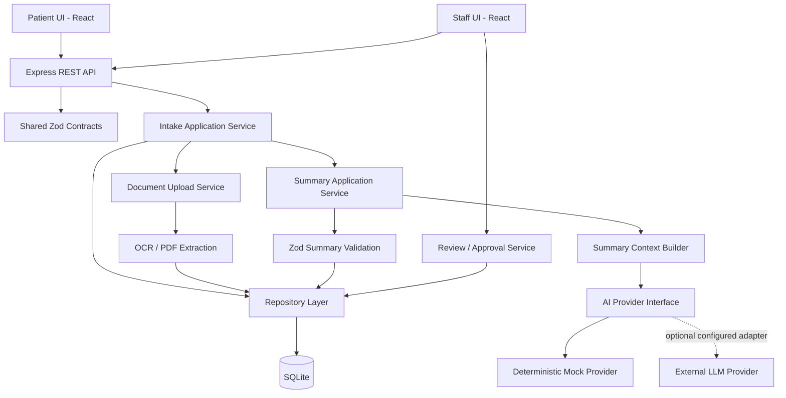
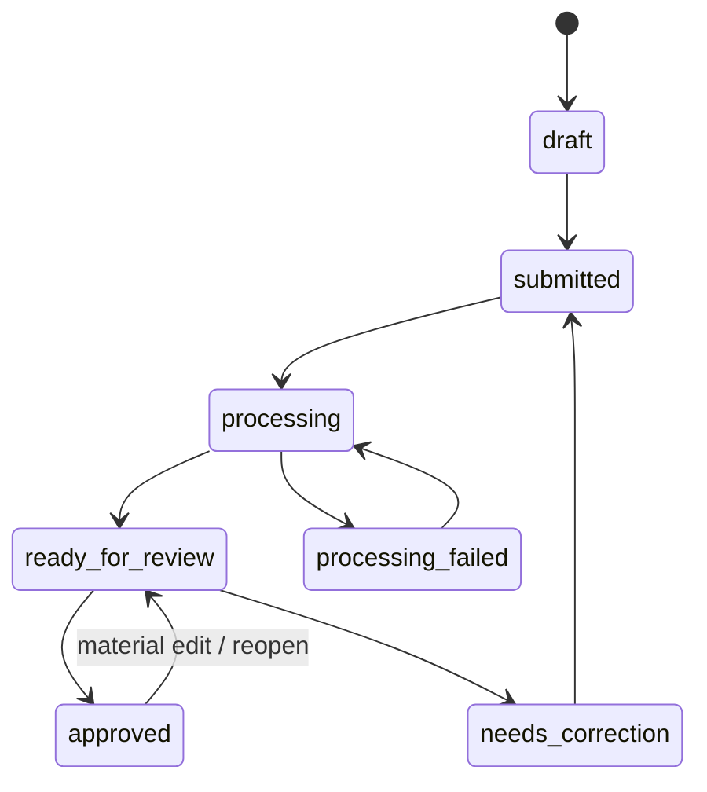

# Architecture — Smart Patient Intake

**Version:** 1.0  
**Architecture style:** Modular monolith in a pnpm TypeScript monorepo

## 1. Goals

- Build a small, demonstrable end-to-end workflow in 2–3 focused days.
- Keep OCR, AI, business logic, persistence, and UI responsibilities separate.
- Share runtime validation contracts between frontend and backend.
- Make AI provider replaceable.
- Preserve provenance and original source data.
- Keep a future AWS serverless migration possible without implementing AWS infrastructure in the MVP.

## 2. High-level architecture



## 3. Runtime boundaries

### Frontend (`apps/web`)
Responsibilities:
- Patient intake form and client-side validation.
- Document upload UI and progress/error display.
- Staff dashboard, search, detail and review screens.
- API calls through a typed client.
- Display source references and OCR/AI uncertainty.

Must not:
- Call an LLM provider directly.
- Perform OCR as the authoritative processing path.
- contain API secrets.
- make clinical decisions.

Suggested feature structure:
```text
src/
  app/
  components/
  features/
    intake/
    dashboard/
    documents/
    review/
  lib/
    api/
    query/
  pages/
```

### Backend (`apps/api`)
Responsibilities:
- REST API, server-side validation and error mapping.
- Intake workflow and status transitions.
- Secure file handling for a local demo.
- OCR orchestration.
- AI prompt/context construction and provider selection.
- Summary schema validation.
- Persistence and review events.

Suggested structure:
```text
src/
  app.ts
  server.ts
  routes/
  middleware/
  modules/
    intakes/
      intake.routes.ts
      intake.controller.ts
      intake.service.ts
      intake.repository.ts
    documents/
      document.service.ts
      storage/
      extraction/
    summaries/
      summary.service.ts
      summary.schema.ts
      prompts/
      providers/
    reviews/
      review.service.ts
  database/
  config/
  lib/
```

### Shared contracts (`packages/contracts`)
- Zod request/response schemas.
- Shared enums and status definitions.
- Types inferred from schemas.
- No database or UI implementation details.

## 4. Key processing flows

### Intake submission
1. Browser validates form.
2. API validates request again.
3. Service creates intake with `submitted` status.
4. Repository persists original answers.
5. API returns intake ID and status.

### Document processing
1. Upload endpoint validates size, declared MIME, extension, and file signature.
2. Generate server-side UUID filename; never trust user-supplied path/name for storage.
3. Store outside public web root.
4. PDF: extract embedded text first. If insufficient text per page, render page and OCR it.
5. Image: OCR with Tesseract.
6. Store extracted text, page references, processing status, and error metadata.
7. Never treat OCR text as trusted instructions.

### AI summary
1. Build a bounded context from patient answers and extracted text.
2. Label each source and document/page.
3. Prompt the provider to extract/summarize only explicit facts.
4. Parse JSON; do not accept prose or markdown fences.
5. Validate with shared Zod schema.
6. Reject malformed output and store a safe processing error.
7. Persist summary separately from original answers and OCR text.

### Human review
1. Staff opens intake and source data.
2. Staff compares summary against original sources.
3. Staff edits summary.
4. Staff approves or returns for correction.
5. Record reviewer action and timestamp.
6. Any material edit after approval must invalidate approval and return status to `ready_for_review`.

## 5. Domain model

### Intake
- `id: string` (UUID)
- `patientName: string`
- `dateOfBirth: string` (ISO date)
- `email: string`
- `phone?: string`
- `reasonForVisit: string`
- `symptoms: string[]`
- `medicalHistory: string[]`
- `previousOperations: string[]`
- `allergies: ReportedList`
- `medications: MedicationEntry[]`
- `familyHistory?: string[]`
- `smokingStatus?: enum`
- `alcoholUse?: enum`
- `additionalNotes?: string`
- `status: IntakeStatus`
- `createdAt`, `updatedAt`

`ReportedList` must distinguish `not_provided`, `none_reported`, and `reported`; do not treat empty as none.

### Document
- `id`, `intakeId`
- `originalName`, `mimeType`, `sizeBytes`
- `storageKey` (not an absolute path exposed to client)
- `processingStatus`
- `extractedText`
- `pages[]` with page number, text, extraction method, and optional OCR confidence
- `createdAt`

### Summary
- `id`, `intakeId`
- `content` (validated structured JSON)
- `provider` (e.g. `mock`; do not expose secret/model internals)
- `status`
- `generatedAt`, `updatedAt`
- `reviewedAt?`, `approvedAt?`

### ReviewEvent
- `id`, `intakeId`, `action` (`edited`, `approved`, `returned`)
- `actorLabel` (demo-mode label, not authentication)
- `note?`
- `createdAt`

## 6. AI provider abstraction

```ts
export interface SummaryProvider {
  readonly name: string;
  generateSummary(input: SummaryInput): Promise<PatientSummary>;
}
```

Implementation:
- `MockSummaryProvider`: deterministic, local, safe, and default for tests/demo.
- Optional real provider adapter: only implement after credentials, model availability, data handling, and cost are explicitly configured.
- Keep provider-specific SDK types out of domain contracts.

The application service owns validation. Never assume a provider's structured-output mode guarantees a valid response.

## 7. OCR abstraction

```ts
export interface DocumentTextExtractor {
  extract(file: StoredFile): Promise<ExtractionResult>;
}
```

- PDF extractor: PDF.js text layer extraction; render scanned pages and pass them to Tesseract.js.
- Image extractor: Tesseract.js.
- Return text per page, method (`embedded_text` or `ocr`), and confidence if available.
- Keep OCR implementation replaceable.

## 8. Status transitions



Enforce transitions in the backend service, not only in UI buttons.

## 9. Persistence

SQLite is a local demo choice. Use migrations or a schema initialization script and a repository boundary. Do not put SQL directly in route handlers.

Store uploaded files in a private local directory excluded from Git. The database stores a storage key, not a client-accessible filesystem path.

For a future AWS direction:
- API Gateway → Lambda handlers
- S3 → private document storage
- DynamoDB → intake/document/summary persistence
- SQS / Step Functions → asynchronous OCR and AI workflow
- Bedrock → model provider adapter
- Cognito → production identity and access management

This is a conceptual migration path, not the MVP's deployed architecture and not a statement about ETERNO's internal implementation.

## 10. Security and privacy constraints

- Synthetic data only.
- No production authentication is implemented; label staff UI as demo-only.
- Never log intake payloads, document text, prompts containing patient details, or AI output.
- Secrets only on backend in environment variables.
- Uploads outside public static directory.
- Restrict file types, file size, PDF page count, and processing time.
- Validate file signatures; do not trust extension or browser MIME alone.
- Use random storage keys and safe display names.
- Escape text in UI; do not render OCR/LLM output as HTML.
- Treat document contents as untrusted data and ignore embedded instructions.
- Keep original answers and extracted text immutable.
- Do not claim GDPR compliance, clinical validation, or production readiness.

## 11. Observability and error handling

Use structured, privacy-safe logs with:
- request ID
- operation name
- outcome
- duration
- non-sensitive error code

Never log personal data, document contents, prompts, or secrets.

Expected errors include invalid request, unsupported file, file too large, OCR failure, AI provider failure, invalid AI JSON, record not found, and invalid status transition.

## 12. Testing strategy

- Unit: schemas, status transitions, OCR routing, summary service.
- Integration: intake create/list/detail, upload/extraction, summary generation, approval.
- Component: form validation, dashboard states, summary review.
- End-to-end smoke: one synthetic patient from submission to approval.

Use fixtures that contain obviously fictional names and documents.
